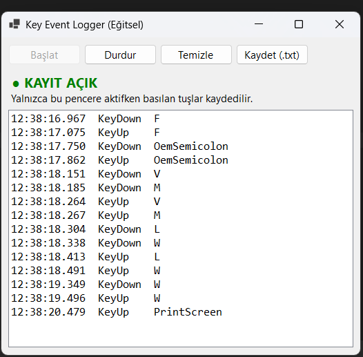
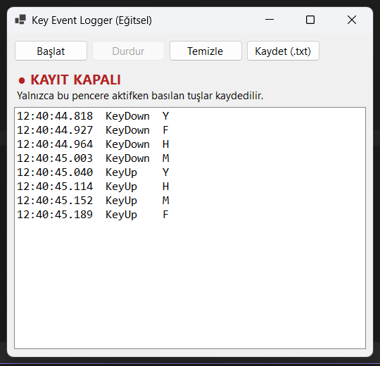

# YMH219-KeyEventLogger

Klavye olaylarının nasıl yakalandığını gösteren eğitsel bir Windows Forms uygulaması. Nesne Tabanlı Programlama (YMH 219) dersi uygulama ödevidir.

**Öğrenci:** EfeKaan Durmaz - 250541106 

## Kullanılan Teknolojiler
- C#
- .NET (Windows Forms)
- Visual Studio
- Harici NuGet paketi yok

## Kurulum ve Çalıştırma
1. Depoyu klonlayın: `git clone https://github.com/Efekaandurmaz/YMH219-KeyEventLogger.git`
2. `.slnx` dosyasını Visual Studio ile açın.
3. **F5** ile çalıştırın.

## Temel Özellikler
- Başlat ve Durdur butonları ile kayıt kontrolü
- Basılan tuş adı ve saat bilgisinin (KeyDown / KeyUp) listede gösterilmesi
- Temizle butonu ile listenin silinmesi
- Kayıtların `.txt` dosyasına kaydedilmesi
- Kayıt durumunu gösteren yeşil/kırmızı gösterge
- Dosya kaydetme sırasında hata yönetimi

## Kapsam ve Güvenlik
Bu uygulama gerçek bir keylogger değildir. Yalnızca kendi penceresi aktifken tuşları yakalar. Global hook, arka planda çalışma, otomatik başlatma, ağ üzerinden veri gönderme ve başka uygulamalardan veri toplama yoktur.

## Ekran Görüntüleri

## Bilinen Sınırlamalar
- Yalnızca uygulama penceresi odaktayken çalışır.
- Tuş istatistiği ve tarih filtresi bulunmamaktadır.
